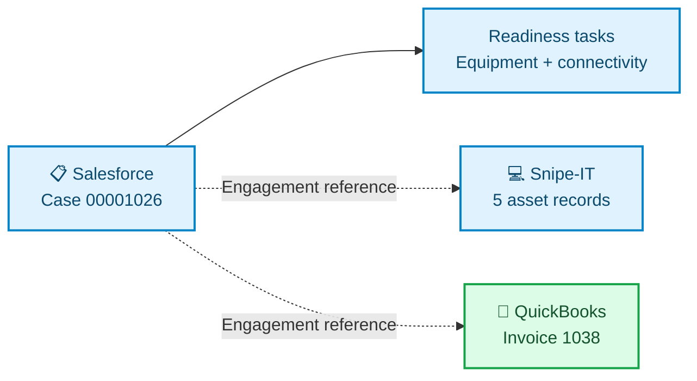
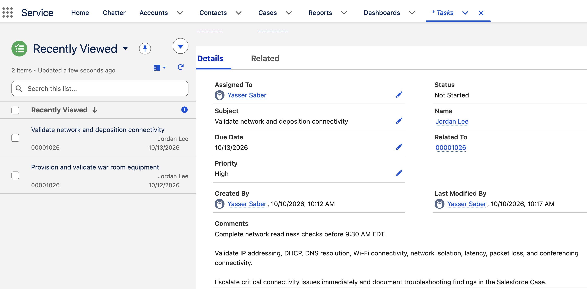
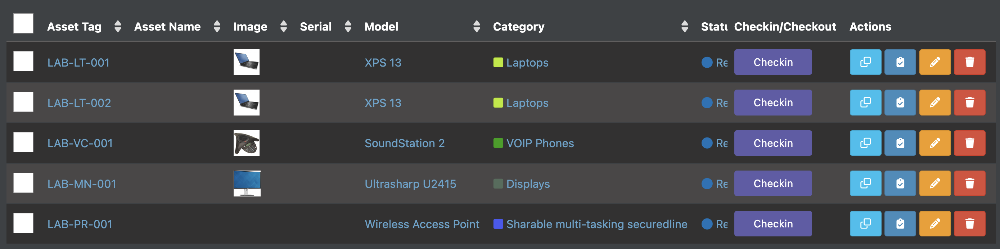
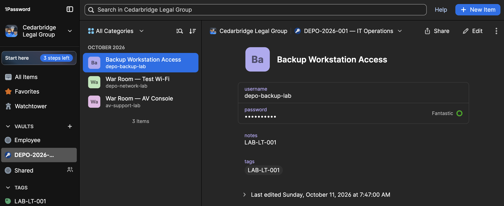
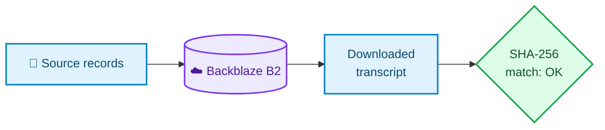
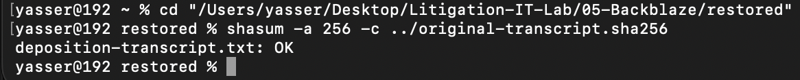
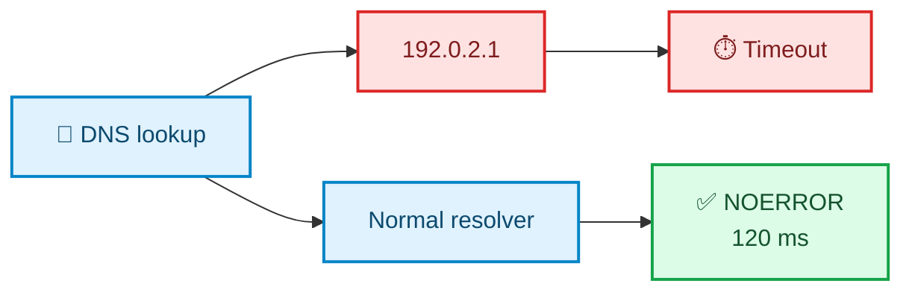
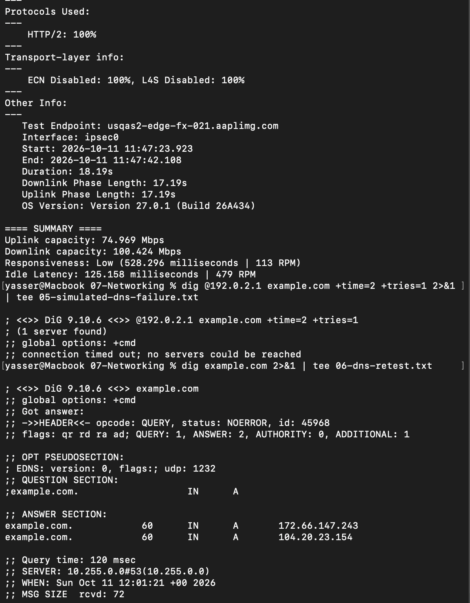

# ⚖️ Litigation War Room & Deposition IT Operations

### Service Coordination • Equipment Tracking • Credential Administration • Verified Recovery • Network Diagnostics

> **Organized a deposition-support workflow across service requests, equipment, access, recovery, billing, and connectivity checks — with a verified transcript restoration and documented DNS troubleshooting results.**

---

## 📌 Project at a Glance

| | |
|---|---|
| **Purpose** | Prepare and document technology readiness for a hybrid deposition |
| **Reference** | **DEPO-2026-001** · Salesforce Case **00001026** |
| **Scope** | Five asset records · Three credential records · Transcript recovery · Service invoice · Network diagnostics |
| **Coordination** | Manual updates, shared engagement references, and asset tags linking equipment, credentials, and recovery records |

---

## 🏗️ Project Workflow

### 1️⃣ Salesforce — Service Requests & Readiness Planning

- Created **Case 00001026**, assigned High priority and an owner, and recorded **DEPO-2026-001**.
- Added equipment and connectivity tasks with deadlines, readiness instructions, and escalation guidance.

Dashed connections represent manual record coordination through **DEPO-2026-001**.

  
   Priority, ownership, deadlines, and escalation instructions captured in the readiness tasks.

**Next enhancement:** deploy an operational [Service Cloud edition](https://www.salesforce.com/service/pricing/) with response milestones, queues, and escalation workflows appropriate to the selected license.

### 2️⃣ Snipe-IT — Equipment Inventory & Checkout

Registered five assets and captured their checkout state, providing identifiable equipment references for the remaining phases.

| Asset tag | Equipment |
|---|---|
| LAB-LT-001 / LAB-LT-002 | Two Dell XPS 13 laptops |
| LAB-VC-001 | SoundStation 2 |
| LAB-MN-001 | UltraSharp U2415 display |
| LAB-PR-001 | Wireless access point |

  
   Asset tags, models, and checkout state preserved in the equipment register.

**Next enhancement:** maintain a persistent private inventory with [paid hosting](https://snipeitapp.com/pricing) for managed backups, upgrades, and support. Self-hosted software remains free.

### 3️⃣ 1Password — Credential Organization & Guest Access

Created the **DEPO-2026-001 — IT Operations** vault with AV console, test Wi-Fi, and backup workstation credential records. Assigned guest access and linked the workstation record to **LAB-LT-001** from the equipment inventory.

  
   Equipment-related credentials organized in a dedicated engagement vault.

**Next enhancement:** maintain Business access beyond the trial and configure permission reviews, verified offboarding, and [audit-log monitoring](https://support.1password.com/activity-log/).

### 4️⃣ Backblaze B2 — Record Storage & Verified Recovery

Uploaded the transcript, equipment reference, and exhibit register. Restored the transcript and checked its **SHA-256 checksum** against the original.

  
   Recovery check returned <code>deposition-transcript.txt: OK</code>.

**Next enhancement:** configure scheduled backups and recurring restore checks; use [paid capacity](https://www.backblaze.com/cloud-storage/pricing) for larger archives. [Object Lock](https://www.backblaze.com/docs/cloud-storage-object-lock) adds retention protection without an additional feature charge.

### 5️⃣ QuickBooks — Engagement Billing

Created **invoice 1038**, placing **DEPO-2026-001** in the service description to connect billing with the support request.

| Service description | Quantity | Rate | Before-tax amount |
|---|---:|---:|---:|
| Room setup, connectivity validation, and technical support | 3 hours | $100 | **$300** |

**Next enhancement:** add accountant collaboration and project profitability reporting with an appropriate [paid plan](https://quickbooks.intuit.com/online/), associating time and equipment costs with the engagement.

### 6️⃣ macOS Networking — Diagnostics & Readiness Assessment

Used **dig**, **ping**, and **networkQuality** to measure the connection and compare DNS resolver behavior.

| Check | Recorded result |
|---|---|
| Ping to 1.1.1.1 | **10/10 replies**, **0% loss**, **115.594 ms** average |
| Download / upload | **100.424 / 74.969 Mbps** |
| Responsiveness under load | **Low — 528.296 ms** |
| Normal DNS retest | **NOERROR**, two answers, **120 ms** |

The controlled DNS test affected one query without changing system settings. Low responsiveness identified a follow-up requirement: validate conferencing under load.

  
   Recorded performance findings alongside the expected DNS failure and successful normal lookup.

**Next enhancement:** deploy the [proposed staff, guest, and AV VLAN design](network-tests/Network-Plan.md) on managed network equipment; verify guest isolation and audio, video, and screen sharing under load.

---

## ✅ Key Outcomes

- **Traceable operational records:** shared engagement reference across service coordination, credential organization, recovery documentation, and invoicing.
- **Verified file recovery:** restored transcript matched the original SHA-256 checksum.
- **Evidence-based network assessment:** captured successful connectivity and DNS results while identifying low responsiveness requiring further validation.

---

## 💡 Skills Developed

| Skill | Evidence in this project |
|---|---|
| **Service coordination** | Prioritized Salesforce case, task ownership, readiness deadlines, escalation instructions |
| **Asset administration** | Equipment registration, asset tags, inventory consistency, checkout tracking |
| **Credential administration** | Dedicated vault, guest provisioning, equipment-linked credential records |
| **Backup and recovery** | Cloud uploads, file restoration, SHA-256 integrity verification |
| **Network troubleshooting** | DNS comparison, packet-loss and latency analysis, performance reporting |
| **Segmentation planning** | Proposed staff, guest, and AV network design |
| **Operational documentation** | Shared references, saved diagnostic outputs, service invoice, readiness records |

---

## 📚 Supporting Files

- [Network design](network-tests/Network-Plan.md)
- [Raw network diagnostic records](network-tests/)
- [Back to my projects portfolio](https://github.com/SaberYasser/Profile)
